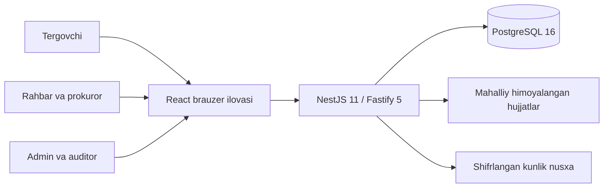
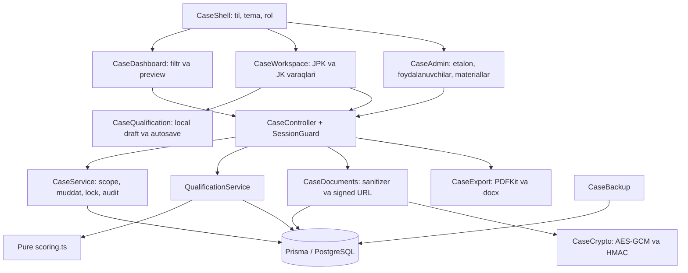
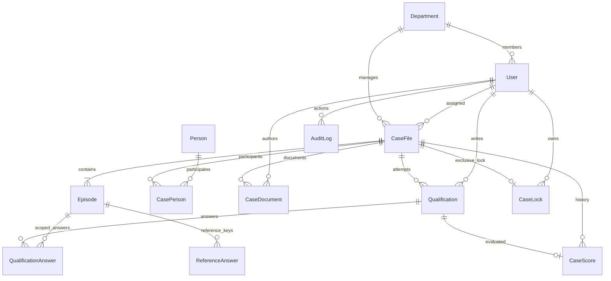
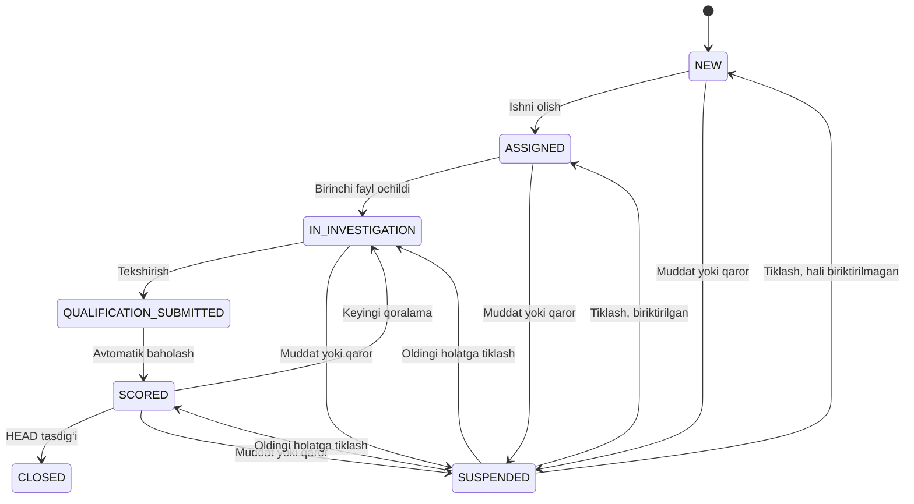

# Jinoyat ishi v2 — arxitektura

## Chegara va huquqiy qatlamlar

Yangi modul `/case-files` sahifalarida va `/api/v1` API orqali ishlaydi. Avvalgi o‘quv o‘yinidagi `Case`, `UserCase`, ball/unvonlar va profil saqlanadi. Yangi 100 ballik baho eski tajriba ballariga qo‘shilmaydi. Bazadagi `CaseFile` ushbu modulning **Jinoyat ishi** agregatidir; nom alohida tanlanishi eski ma’lumotlarga moslikni saqlaydi.

JPK qatlami: ish, epizod, muddat, biriktirish, ishtirokchilar va protsessual hujjatlar. JK qatlami: kvalifikatsiya qoralamasi, beshta element, admin etaloni va baho. Ishtirokchining protsessual `CasePerson.role` qiymati bilan jinoyatdagi `personId + role` juftligi alohida saqlanadi.

Huquqiy manbalar: [JPK](https://www.lex.uz/mact/-111460), [JK](https://www.lex.uz/uz/acts/-111453). JK 28-moddasidagi atama **yordamchi** bo‘lgani uchun TZdagi `HOMIYDA` o‘rniga `YORDAMCHI` ishlatiladi. JK 17-moddasidagi umumiy 16 yosh qoidasida jinoyat turiga qarab istisnolar bor. Shu sabab hodisa vaqtidagi yosh 16 dan kichik bo‘lsa ogohlantirish chiqadi; tizim javobni o‘zi taqiqlamaydi. UI xulosasi sud qarori yoki huquqiy maslahat o‘rnini bosmaydi. Manbalar 2026-11-22 kuni tekshirildi.

## C4: kontekst

## C4: konteyner va komponentlar

Asosiy kod: `apps/api/src/case-module/`, `apps/web/src/features/case-module/`, umumiy Zod kontraktlari `packages/shared/src/case-module/`. Kvalifikatsiya maydonlari admin va tergovchi shakllarida bitta `QualificationFields` komponentidan olinadi. Yangi sahifalar lazy yuklanadi.

## ERD

`Qualification` bitta ish va bitta muallifning barcha epizodlarini qamrab oladi. Har javobda `caseId + episodeId + elementType` mavjud. Qo‘shma FKlar boshqa ish epizodini yoki kvalifikatsiyasini ulashni rad etadi. `ReferenceAnswer` epizod orqali ishga bog‘lanadi. `CaseScore` ichida natija, urinish raqami va yopiq etalon snapshoti saqlanadi; snapshot javob serializatorlariga kiritilmaydi.

Migratsiya: `apps/api/prisma/migrations/202611220003_case_module/migration.sql`. Qo‘shimcha jadvallar, 3 yangi rol va `User.departmentId` mavjud. Mavjud foydalanuvchilar ACADEMY bo‘linmasiga biriktiriladi. `CHECK`lar: sanalar tartibi, yopilish sanasi, biriktirilgan holatlar, musbat epizod vazni, ball 0..100, urinish 1..3, lock sanalari, etalonning qat’iy vaznlari. Partial unique indeks har muallif/ishda faqat bitta DRAFTni ta’minlaydi. Ma’lumotlarni o‘chiradigan yoki reset qiladigan migratsiya yo‘q.

## Ruxsatlar

| Rol        | Preview | Olish          | Hujjat/shaxslar       | Kvalifikatsiya    | Etalon     | Natija          |
| ---------- | ------- | -------------- | --------------------- | ----------------- | ---------- | --------------- |
| USER       | Ha      | O‘z bo‘linmasi | Biriktirilgan ish     | O‘z ishiga yozadi | Yo‘q       | O‘z urinishlari |
| HEAD       | Ha      | Yo‘q           | O‘z bo‘linmasi        | O‘qiydi           | Yo‘q       | O‘z bo‘linmasi  |
| PROSECUTOR | Ha      | Yo‘q           | Hammasi               | O‘qiydi           | Yo‘q       | Hammasi         |
| ADMIN      | Ha      | Yo‘q           | Hammasi               | Yo‘q              | Boshqaradi | Hammasi         |
| AUDITOR    | Ha      | Yo‘q           | O‘qiydi, PII yashirin | Yo‘q              | Yo‘q       | O‘qiydi         |

HEAD ishni faol bo‘linma tergovchisiga qayta biriktiradi, to‘xtatadi, tiklaydi va yopishni tasdiqlaydi. ADMIN hisob roli, bo‘linmasi va bloklanishini o‘zgartiradi; sessiyalar bekor qilinadi. O‘z admin huquqini olib tashlash va oxirgi faol adminni o‘chirish taqiqlanadi. AUDITOR auditni o‘qiydi. Admin hamda auditor oddiy kvalifikatsiya javoblarini ololmaydi. Eski o‘yin API huquqlari ushbu yangi modul matritsasidan mustaqil.

## Holatlar va bir vaqtdagi amallar

Claim, qoralama yozish, submit, etalonni almashtirish va rahbar qarorlari `CaseFile SELECT ... FOR UPDATE` orqali ketma-ket bajariladi. Lock 24 soatga beriladi va egasi yangilaydi. Qulf tugashi yoki bo‘shatilishi biriktirishni bekor qilmaydi: boshqa tergovchiga faqat HEAD o‘tkazadi. Uch urinish limiti ish bo‘yicha umumiy, qayta biriktirishda yangilanmaydi. Submitning oraliq holatlari bitta tranzaksiyada commit bo‘ladi. Muddat har tegishli so‘rovda va server ishlaganda har 60 soniyada tekshiriladi.

## Baholash

Juftliklar va checkbox qiymatlari to‘plamga aylantiriladi. F1 = `2 * kesishma / (etalon soni + javob soni)`; ikkisi ham bo‘sh bo‘lsa 1, faqat biri bo‘sh bo‘lsa 0.

- SUBJECT: shaxs/rol juftligi F1 × 50.
- PARTICIPATION: mustaqil juftlik F1 × 12.5; bo‘sh ro‘yxat mumkin.
- OBJECT: checkbox to‘plami F1 × 12.5.
- OBJECTIVE: harakat, oqibat F1 va sababiy bog‘lanish — uchta teng ulush.
- SUBJECTIVE: aybdorlik, motiv, maqsad; etalonda qasddan bo‘lsa qasd turi ham qo‘shilib, to‘rtta teng ulush. Zarurlik tergovchi javobi bilan o‘zgarmaydi.

Izohlar baholanmaydi. Har epizod 100 ball, umumiy baho epizod vaznlari bo‘yicha o‘rtacha. Faqat yakuniy umumiy baho 2 kasrgacha yaxlitlanadi. Eng yaxshi urinish yakuniy hisoblanadi; tergovchiga ko‘rsatiladigan tarix va eng yaxshi ball o‘z urinishlari bilan cheklanadi. Rahbar/prokuror/admin barcha ruxsat etilgan urinishlarni ko‘radi. Etalon yo‘q bo‘lsa 422. Etalon keyin o‘zgarsa eski ball qayta yozilmaydi, eski revision/snapshot saqlanadi.

## Xavfsizlik va saqlash

JWT 15 daqiqa; refresh 7 kun, rotation va reuse aniqlanganda oilani bekor qilish mavjud. `/api/v1/auth/login`, `refresh`, `logout` Bearer mijozlari uchun; eski cookie autentifikatsiya brauzer bilan mos. Parol xeshlari, JWT va refresh qiymatlari javob auditida saqlanmaydi.

PINFL va manzil AES-256-GCM bilan shifrlanadi; HMAC va PII kalitlari turli kontekstlardan olinadi. Auditor faqat PINFLning oxirgi 4 raqamini va yashirilgan manzilni oladi. Kalit `.local/http-secret` yoki barqaror `JWT_SECRET`dan olinadi: kalitni almashtirishdan oldin ma’lumotlarni qayta shifrlash kerak.

Hujjatlar public papkaga tushmaydi. Har URL 15 daqiqa, shaxsga va fayl hashiga bog‘langan. URL egasining autentifikatsiyasi va joriy ruxsati yana tekshiriladi. Rasmlar Sharp orqali WebPga aylantiriladi; PDF faol katalog amallari, formalar va annotatsiyalardan tozalanadi. Buzilgan/shifrlangan va 100 sahifadan katta PDFlar rad etiladi. Maksimal kirish fayli 4 MiB. Antivirus integratsiyasi prototipda yo‘q.

Autosave 2 soniya, 30 soniyalik zaxira taymer mavjud. Offline qoralama user/case kaliti bilan localStorage’da 24 soat turadi; faqat kvalifikatsiya tanlovi va izohlar saqlanadi, shaxslarning PINFL/manzili yoki etalon saqlanmaydi. Oxirgi yuborilgan javob yutadi, `baseVersion` tafovuti audit va ko‘rinadigan ogohlantirishga aylanadi. Logout/parol almashtirish mahalliy qoralamalarni o‘chiradi. Umumiy qurilmada brauzer profilini himoyalash baribir zarur.

Kunlik nusxa: server ishlaganda kuniga bir marta va `pnpm backup:case-module` orqali qo‘lda. PostgreSQL REPEATABLE READ snapshotidagi jadvallar JSON matni sifatida, aniqlikni yo‘qotmay saqlanadi; hujjatlar, avatarlar va lokal kalit bilan gzip arxivga olinadi, AES-256-GCM bilan shifrlanadi. Retention 30 kun. Bu `pg_dump` formati emas. Fayllar DB snapshotidan keyin arxivlanadi; ishlab chiqarish muhitida DB va fayllarni bitta vaqt nuqtasida tiklash uchun tashqi backup tizimi kerak. Nusxa hamda kalitni alohida qurilmaga ko‘chirish va amaliy restore sinovi operator zimmasida. Ilova o‘chiq paytda taymer ishlamaydi; doimiy server yoki OS rejalashtiruvchisi kerak.

## Sifat chegarasi

Bu ishlaydigan lokal prototip. Qog‘oz ko‘rinishi, uch til, klaviatura bilan tablar, aniq fokus va reduced motion mavjud. Avtomatik axe natijasi WCAG sertifikati emas; yakuniy screen-reader va inson tekshiruvi talab etiladi. P95 sinovi lokal Fastify so‘rovi + PostgreSQL vaqtini o‘lchaydi; internet, ko‘p foydalanuvchili yuk va katta bazadagi SLAni tasdiqlamaydi. Redis avvalgi launcher bilan qoladi; yangi lockning yagona manbasi PostgreSQL.

Eksport QA: PDFlar rastrga aylantirilib sahifalar tekshiriladi. DOCX ZIP/XML va brauzer preview orqali tekshirildi; bu kompyuterda LibreOffice mavjud emas, Word COM renderi yakunlanmadi. Worddagi aniq sahifalash tasdiqlanmagan.
